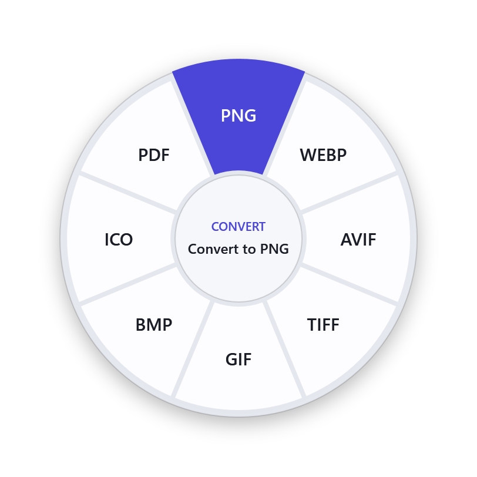
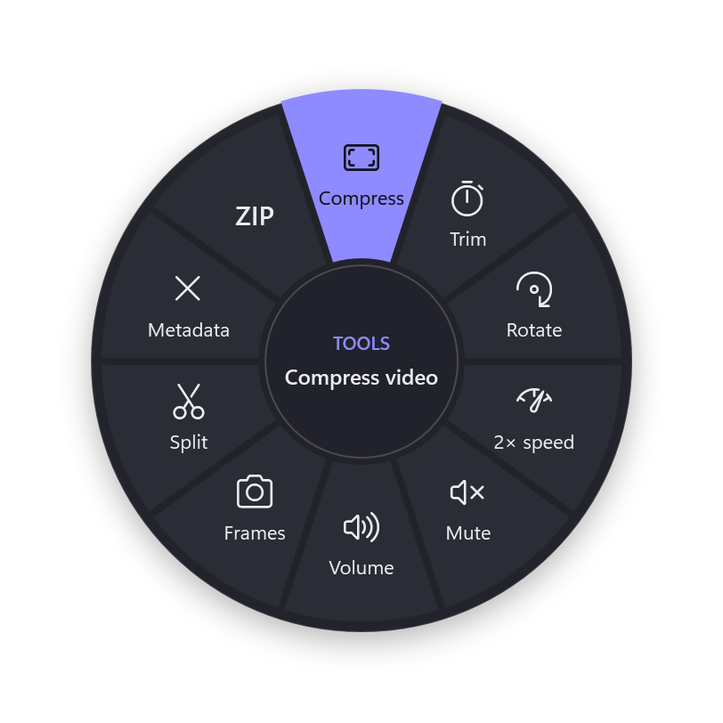

# Mo Converter

[Deutsch](#deutsch) · [English](#english) · [العربية](#العربية)

<p align="center">
  
  
</p>

---

## Deutsch

**Mo Converter** wandelt Dateien um, komprimiert und bearbeitet sie, ohne den Ordner zu verlassen. Ziehen Sie eine Datei im Explorer, halten Sie eine Taste – und lassen Sie sie auf einem Feld des Rades los. Alles läuft **auf Ihrem Computer**; es wird nichts hochgeladen.

| Taste beim Ziehen | Rad | Beispiele |
|---|---|---|
| **Umschalt** | Umwandeln | PNG → WEBP, PDF → Word, MP4 → GIF, CSV → Excel |
| **Strg** | Werkzeuge | Komprimieren, Drehen, Zusammenführen, Seiten anordnen, Text erkennen |
| **Alt** | Aktionen | Pfad kopieren, im Explorer zeigen, ZIP, QR-Code lesen |

Die Tasten lassen sich in den Einstellungen ändern.

### Was es kann (76 Vorgänge)

- **Bilder** – PNG, JPG, WEBP, AVIF, TIFF, GIF, BMP, ICO ineinander umwandeln; komprimieren, zuschneiden, drehen, Farben anpassen, Bereiche unkenntlich machen (Gesichter, Kennzeichen), Metadaten entfernen, Text erkennen (OCR mit den in Windows installierten Sprachen), Collage, QR-Codes lesen und erzeugen.
- **PDF** – in Word, Excel (mit Tabellenerkennung), PowerPoint, Markdown, EPUB, Text oder Bilder umwandeln; zusammenführen, teilen, Seiten anordnen und drehen, komprimieren, gescannte Seiten per OCR lesen.
- **Video und Audio** – MP4, MOV, MKV, WEBM, GIF, MP3, M4A, WAV, FLAC, OGG, OPUS; komprimieren, kürzen, drehen, Tempo ändern, Ton entfernen, Lautstärke angleichen, Einzelbilder speichern, teilen, zusammenfügen.
- **Dokumente, Tabellen, Präsentationen** – Word, Markdown, Text, HTML, EPUB, CSV, Excel; mit [LibreOffice](https://www.libreoffice.org) (falls installiert) auch PDF und OpenDocument.
- **Archive und Untertitel** – ZIP, 7z, RAR, TAR.GZ entpacken (sicher gegen manipulierte Pfade) und als ZIP neu packen; SRT, VTT, ASS und SBV ineinander umwandeln.
- **Ablage** – ein schwebendes Fenster für Ergebnisse, aus dem Sie Dateien wieder herausziehen.
- **Kommandozeile** – `mo list <dateien>` und `mo run <vorgang> <dateien> [--out <ordner>]`.
- **Deutsch, Englisch, Arabisch** – die ganze Oberfläche, auch von rechts nach links; helles und dunkles Design.

Ergebnisse überschreiben nie eine vorhandene Datei: gibt es den Namen schon, wird „Name (2)“ verwendet.

### Installation

Laden Sie `MoConverter-win-Setup.exe` aus den [Releases](https://github.com/mohamadmourad91/Mo-Converter/releases). Voraussetzung: Windows 10 (Version 2004) oder Windows 11, 64 Bit. Updates werden automatisch geladen und sind verpflichtend, damit alle dieselbe Version nutzen.

### Selbst bauen

```powershell
./build/get-ffmpeg.ps1            # einmalig: FFmpeg (LGPL-Build) herunterladen
dotnet build MoConverter.slnx
dotnet test MoConverter.slnx
./build/release.ps1 -Version 1.0.0   # Installer in artifacts\releases
```

Benötigt das .NET-10-SDK. Aufbau: `src/Mo.Engine` (Vorgänge), `src/Mo.App` (Rad, Fenster), `src/Mo.Cli` (Kommandozeile).

### Lizenz

MIT, siehe [LICENSE](LICENSE). Verwendete Software anderer Autoren (u. a. FFmpeg unter LGPL) steht in [THIRD-PARTY-NOTICES.md](THIRD-PARTY-NOTICES.md).

---

## English

**Mo Converter** converts, compresses and edits files without leaving the folder. Drag a file in Explorer, hold a key, and drop it on a segment of the wheel. Everything runs **on your computer**; nothing is uploaded.

| Key while dragging | Wheel | Examples |
|---|---|---|
| **Shift** | Convert | PNG → WEBP, PDF → Word, MP4 → GIF, CSV → Excel |
| **Ctrl** | Tools | Compress, rotate, merge, arrange pages, read text |
| **Alt** | Actions | Copy path, show in Explorer, ZIP, read QR code |

The keys can be changed in the settings.

### What it does (76 operations)

- **Images** – convert between PNG, JPG, WEBP, AVIF, TIFF, GIF, BMP, ICO; compress, crop, rotate, adjust colours, hide areas (faces, number plates), remove metadata, read text (OCR, in the languages installed in Windows), make a collage, read and create QR codes.
- **PDF** – to Word, Excel (with table detection), PowerPoint, Markdown, EPUB, text or images; merge, split, arrange and rotate pages, compress, read scanned pages with OCR.
- **Video and audio** – MP4, MOV, MKV, WEBM, GIF, MP3, M4A, WAV, FLAC, OGG, OPUS; compress, trim, rotate, change speed, remove sound, even out volume, save frames, split, join.
- **Documents, spreadsheets, presentations** – Word, Markdown, text, HTML, EPUB, CSV, Excel; with [LibreOffice](https://www.libreoffice.org) (if installed) also PDF and OpenDocument.
- **Archives and subtitles** – extract ZIP, 7z, RAR, TAR.GZ (safe against tampered paths) and repack as ZIP; convert between SRT, VTT, ASS and SBV.
- **Shelf** – a floating window for results; drag files back out of it.
- **Command line** – `mo list <files>` and `mo run <operation> <files> [--out <folder>]`.
- **English, German, Arabic** – the whole interface, including right-to-left; light and dark themes.

Results never overwrite an existing file: if the name is taken, "name (2)" is used.

### Install

Download `MoConverter-win-Setup.exe` from the [releases](https://github.com/mohamadmourad91/Mo-Converter/releases). Requires Windows 10 (version 2004) or Windows 11, 64-bit. Updates download automatically and are mandatory, so everyone runs the same version.

### Build it yourself

```powershell
./build/get-ffmpeg.ps1            # once: fetch the LGPL build of FFmpeg
dotnet build MoConverter.slnx
dotnet test MoConverter.slnx
./build/release.ps1 -Version 1.0.0   # installer in artifacts\releases
```

Needs the .NET 10 SDK. Layout: `src/Mo.Engine` (operations), `src/Mo.App` (wheel, windows), `src/Mo.Cli` (command line).

### License

MIT, see [LICENSE](LICENSE). Software by other authors (including FFmpeg under the LGPL) is listed in [THIRD-PARTY-NOTICES.md](THIRD-PARTY-NOTICES.md).

---

<div dir="rtl">

## العربية

**Mo Converter** يحوّل الملفات ويضغطها ويعدّلها دون أن تغادر المجلد. اسحب ملفًا في مستكشف الملفات، واضغط مطولًا على مفتاح، ثم أفلته على أحد أجزاء العجلة. كل شيء يجري **على جهازك**، ولا يُرفع أي شيء.

| المفتاح أثناء السحب | العجلة | أمثلة |
|---|---|---|
| **Shift** | تحويل | PNG ← WEBP، وPDF ← Word، وMP4 ← GIF، وCSV ← Excel |
| **Ctrl** | أدوات | ضغط، وتدوير، ودمج، وترتيب الصفحات، وقراءة النص |
| **Alt** | إجراءات | نسخ المسار، وإظهاره في المستكشف، وZIP، وقراءة رمز QR |

يمكن تغيير المفاتيح من الإعدادات.

### ما يستطيع فعله (76 عملية)

- **الصور** – تحويل بين PNG وJPG وWEBP وAVIF وTIFF وGIF وBMP وICO؛ وضغط وقص وتدوير وتعديل الألوان، وإخفاء مناطق (الوجوه ولوحات السيارات)، وإزالة البيانات الوصفية، وقراءة النص (OCR باللغات المثبّتة في Windows)، وصورة مجمّعة، وقراءة رموز QR وإنشاؤها.
- **PDF** – إلى Word وExcel (مع كشف الجداول) وPowerPoint وMarkdown وEPUB ونص وصور؛ ودمج وتقسيم وترتيب الصفحات وتدويرها، وضغط، وقراءة الصفحات الممسوحة ضوئيًا بالـOCR.
- **الفيديو والصوت** – MP4 وMOV وMKV وWEBM وGIF وMP3 وM4A وWAV وFLAC وOGG وOPUS؛ وضغط وقص وتدوير وتغيير السرعة، وإزالة الصوت، وتوحيد مستواه، وحفظ الإطارات، وتقسيم ودمج.
- **المستندات والجداول والعروض** – Word وMarkdown ونص وصفحة ويب وEPUB وCSV وExcel؛ ومع [LibreOffice](https://www.libreoffice.org) (إن كان مثبّتًا) أيضًا PDF وOpenDocument.
- **الملفات المضغوطة والترجمات** – فك ضغط ZIP و7z وRAR وTAR.GZ (بحماية من المسارات الخبيثة) وإعادة ضغطها بصيغة ZIP؛ والتحويل بين SRT وVTT وASS وSBV.
- **الرف** – نافذة عائمة للنتائج، تسحب منها الملفات من جديد.
- **سطر الأوامر** – `mo list <ملفات>` و`mo run <عملية> <ملفات> [--out <مجلد>]`.
- **العربية والألمانية والإنجليزية** – الواجهة كلها، ومنها الاتجاه من اليمين إلى اليسار؛ والمظهران الفاتح والداكن.

لا تكتب النتائج فوق ملف موجود: إن كان الاسم مأخوذًا يُستعمل "الاسم (2)".

### التثبيت

نزّل `MoConverter-win-Setup.exe` من صفحة [الإصدارات](https://github.com/mohamadmourad91/Mo-Converter/releases). يتطلب Windows 10 (الإصدار 2004) أو Windows 11، بنظام 64 بت. التحديثات تُنزَّل تلقائيًا وهي **إلزامية**، لكي يعمل الجميع بالإصدار نفسه.

### البناء بنفسك

```powershell
./build/get-ffmpeg.ps1            # مرة واحدة: تنزيل FFmpeg (نسخة LGPL)
dotnet build MoConverter.slnx
dotnet test MoConverter.slnx
./build/release.ps1 -Version 1.0.0   # ملف التثبيت في artifacts\releases
```

يحتاج حزمة .NET 10 SDK. التنظيم: `src/Mo.Engine` (العمليات)، و`src/Mo.App` (العجلة والنوافذ)، و`src/Mo.Cli` (سطر الأوامر).

### الترخيص

MIT، انظر [LICENSE](LICENSE). البرمجيات التي كتبها آخرون (ومنها FFmpeg بترخيص LGPL) مذكورة في [THIRD-PARTY-NOTICES.md](THIRD-PARTY-NOTICES.md).

</div>
